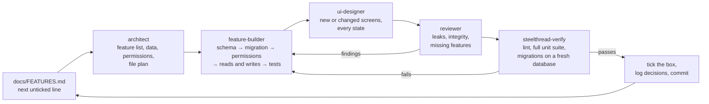

<p align="center">
  
</p>

<p align="center">
  <a href="https://github.com/snehaltayde/steelthread/actions/workflows/tests.yml"></a>
  
  
  <a href="LICENSE"></a>
</p>

A steel thread is the thinnest path that runs through a whole system, end to end.
**Steelthread is a Claude Code plugin that makes Claude build that way:** one feature line at
a time, taken from the data model to its tests, then planned, built, reviewed and verified
before the next one starts.

It is a small kit with strong opinions: four agents, three commands, eight skills, two shell
helpers and one hook. Every claim on this page comes from a test in this repository that
you can run yourself.

```text
/plugin marketplace add snehaltayde/steelthread
/plugin install steelthread@steelthread
```

## What goes wrong in long AI builds, and what this does about it

| What goes wrong | What Steelthread does | How it is checked |
|---|---|---|
| Layers get built one at a time, so you have screens with no data behind them and tables nothing reads | Each feature is one slice: schema → migration → permission checks → reads and writes → UI → tests, finished before the next starts | The [live slice test](#3-a-real-feature-built-live) checks for the migration, the permission rules, the tests and the ticked line |
| A guest can read something only an admin should see | Permissions live in one place per domain and are tested for every role, with the least-trusted role tested on every new read | In the [example project](examples/notes-api), the first slice's 42 tests call `GET /me` as each of the three roles, and the guest has its own test that it sees nothing but its own name and role |
| "Done, all tests pass", when nothing was run | `steelthread-verify` runs every check, keeps going after a failure, and lists skipped checks as NOT RUN in the verdict | 16 checks, including "a failing step still fails the run" and "a skipped step shows in the verdict" |
| Two sessions on one machine, and one runs `pkill node` and stops the other's server | A hook refuses kills by name or by port sweep and tells Claude to kill the exact PID it started | 42 of 42 pattern kills blocked, 31 of 31 ordinary commands allowed |
| Three worktrees run their test suites at once and the machine crawls | `steelthread-lock` lets one heavy command run at a time, machine-wide | 96 commands raced for the lock in 8 rounds of 12, and no two ever ran together |
| The plan is approved line by line and you become the bottleneck | Claude takes the architect's recommendation, logs it in `docs/DECISIONS.md` and lists every decision made for you in its report. It still asks before anything costly or permanent | The live run's report lists its schema and permission decisions first: [the run](examples/README.md) |

## How one slice flows



No agent ticks the box. The session runs the one full check after the review, and only a
passing report ticks the line.

## Quick start

1. Install the plugin (the two lines above), then open a project folder, empty or with
   existing code, and run:

   ```text
   /steelthread:new-project <one line about the product>
   ```

2. Answer its one batch of questions, then approve the stack, the roles and the phase
   list. After that it asks only before something costly or permanent: deleting data, a
   first push, a first production deploy.
3. It builds Phase 0 and carries on line by line with `/steelthread:feature`. Run
   `/steelthread:status` at any time to see where the build stands.

`new-project` writes the project's own documents: `CLAUDE.md` (with the working agreement
included, so the rules travel with the repository), `docs/ARCHITECTURE.md`,
`docs/FEATURES.md`, `docs/DECISIONS.md`, `docs/UI.md` and `docs/PLAYBOOK.md`. Plans are
kept one file per phase in `docs/plans/`.

To try it from a clone without installing:

```bash
claude --plugin-dir ./steelthread
```

## Tested, and how to run the tests yourself

There are three tests. The first is free and needs no Claude session. The other two run
real Claude Code sessions on your account. Details for each are in
[tests/README.md](tests/README.md).

### 1. Script tests: 141 checks, no Claude needed

```bash
bash tests/run.sh
```

| Group | Checks | What it proves |
|---|---|---|
| Lock: one heavy command at a time | 25 | Commands queue, exit codes pass through, a dead holder's lock is taken over, a live one is never stolen, and a stopped run stops its whole process tree |
| Lock: 12 waiters race for a dead lock | 8 | 8 rounds of 12 commands each, and in every round they ran strictly one after another |
| Verify: the honest report | 16 | Every step runs even after a failure, a failure fails the run, and skipped steps show as NOT RUN |
| Hook: pattern kills it must block | 42 | `pkill`, `killall`, `kill $(lsof ...)`, `lsof \| xargs kill`, `npx kill-port`, the same inside `bash -c`, `eval` and heredocs fed to a shell |
| Hook: ordinary commands it must allow | 33 | `kill <pid>`, `kill "$(cat app.pid)"`, and commands that only mention `pkill` in a commit message, a grep or a note |
| Hook: machines without jq or python3 | 17 | The hook still decides correctly when it has to parse its input with sed and awk |
| **Total** | **141** | |

All 141 pass on each of these:

| System | Shell and awk | Result |
|---|---|---|
| macOS 26 (Apple silicon) | bash 3.2, BSD awk | 141 / 141 |
| Ubuntu 24.04 | bash 5.2, mawk | 141 / 141 |
| Alpine 3.20 | bash 5.2, BusyBox awk and ps | 141 / 141 |

The same script runs on GitHub's Ubuntu and macOS machines on every push; the badge at the
top shows the latest result. The hook adds 2 to 8 milliseconds to a Bash call.

### 2. Live smoke test: does the plugin load in a real session?

```bash
bash tests/live-smoke.sh
```

One short headless Claude Code session with the plugin loaded. It checks 18 things from
the session's reply: all 4 agents are registered, all 10 skills Claude can load are
there, `steelthread-verify` ran and reported its skipped step, the hook blocked a `pkill`,
and both helpers are on the PATH.

Our run: **18 of 18, 9 seconds, about 10 US cents.**

### 3. A real feature, built live

```bash
bash tests/live-slice.sh
```

Two headless sessions: `/steelthread:new-project` sets up a small notes API with three
roles (admin, member, guest), then `/steelthread:feature` builds its first line. The script
then checks the result from outside the session: the documents exist, the working
agreement is in `CLAUDE.md` unchanged, the plan was saved, one line is ticked, the
documents were committed before the feature, a migration and permission rules exist, the
tests name all three roles, and the project's tests pass when the script runs them itself.

Our run:

| | |
|---|---|
| Outside checks | **20 of 20 passed** |
| Tests the session wrote for the slice | **42, all passing** when the script ran them itself |
| Agents it started | 1 architect, 2 feature-builders, 2 reviewers (a review, fixes, then a recheck) |
| Time | About 7 minutes (61 seconds to set up, 6 minutes to build the slice) |
| Cost | About 2.02 US dollars (0.34 to set up, 1.68 for the slice; session on Sonnet, builder on Opus) |
| Commits | 3: the documents, the plan, the feature |

Model output differs from run to run, so expect the same shape, not the same code. The
project it built is in [examples/notes-api](examples/notes-api), unedited, and the
session's own finishing report is in [examples/README.md](examples/README.md).

### What a verify report looks like

This is the real report from the example project:

```text
steelthread verify  2026-11-24 02:23  ~/steelthread-run/notes-api  [main 048fa9d]
RESULT    STEP            TIME  DETAIL
PASS      lint              1s  find src test -name '*.js' -print0 | xargs -0 -n1 node --check
PASS      unit              0s  node --test
PASS      migrate-fresh     0s  mkdir -p data && rm -f data/fresh.db && DB_FILE=data/fresh.db node src/migrate.js
NOT RUN   browser            -  no screens in this project

VERDICT: PASSED (3 steps), 1 NOT VERIFIED. Logs: /tmp/steelthread-verify.7Y9bdY
```

And this is what Claude gets back when it tries `kill -9 $(lsof -ti:3000)`:

```text
steelthread: killing processes by name or by port sweep is not allowed here; it can stop
another session's server or database. Kill the exact PID of the process you started (keep
it from the launch, or read the project's PID file).
```

### What has not been tested

- **Better than plain Claude Code, by how much:** not measured. The numbers above show
  that each part does what it says. A fair side-by-side needs many runs of the same
  project with and without the plugin, and we have not done that.
- **`ui-designer` in a live run:** the test project has no screens.
- **A long build:** the live run stops after one line, so the phase-end audit and
  `phase-retro` have not run live.
- **Windows:** the helpers and the hook are bash scripts. They should work under WSL as
  they do on Linux, but nobody has run them there.

If you run any of these, please open an issue with what you found.

## Who it is for

Projects with users in different roles and a database behind them: SaaS apps, internal
tools, client portals. The permission rules are the centre of the method, so it has less
to offer a library or a command-line tool. It is not tied to a stack.

## What it holds Claude to

- **Slices, not layers.** A feature goes schema → migration → permission checks → reads
  and writes → UI → tests. No empty screens for later.
- **The least-trusted role first.** Permissions are tested for every role before the reads
  that depend on them, and the weakest role gets a test on every new read.
- **No scope cutting.** The architect's feature list is a floor. Lean code is welcome;
  fewer features is not.
- **Decisions without waiting.** Claude takes the architect's recommendation, logs it in
  `docs/DECISIONS.md` and keeps going. It still asks before anything costly or permanent.
- **Nothing claimed that was not run.** Every report says what was run, what failed and
  what was not verified.

The full text is [templates/working-agreement.md](templates/working-agreement.md). It is
copied into your project's `CLAUDE.md`, where you can edit it.

## What is inside

| Part | Name | What it does |
|---|---|---|
| Command | `/steelthread:new-project` | Writes a project's documents, for new or existing code |
| Command | `/steelthread:feature` | Builds one slice end to end, then starts the next |
| Command | `/steelthread:status` | Phase progress, the next line, work in flight |
| Agent | `architect` | Feature list, data changes, permissions, file plan, decisions. Writes no code |
| Agent | `feature-builder` | Builds the slice in a fixed order and runs the checks |
| Agent | `ui-designer` | Designs and builds screens from `docs/UI.md`, in every state |
| Agent | `reviewer` | Independent review: leaks, integrity, missing features. Edits nothing |
| Skill | `least-trusted-audit` | The permission test harness and the phase-end audit |
| Skill | `verify-slice` | Runs the checks and reports the real result |
| Skill | `orchestrating-builds` | Worktrees, the merge queue, briefs, keeping usage down |
| Skill | `migration-safety` | Destructive changes, renumbering, fresh-database runs |
| Skill | `slice-writing` | How to write and order feature lines |
| Skill | `adopt-existing-project` | Records an existing codebase as it is |
| Skill | `go-live` | Deploy order, secrets, shared servers, production surprises |
| Skill | `phase-retro` | Turns a phase's mistakes into rules in the project's playbook |

Skills load only when the work calls for them, so they cost almost nothing until then.

### Helpers on the PATH

- `steelthread-verify --step NAME "COMMAND" ... [--skip NAME "REASON"]` runs each check
  under the machine-wide lock, runs all of them even after a failure, and prints one
  report with a verdict. Skipped checks are listed as NOT RUN.
- `steelthread-lock <command>` runs one heavy command at a time on the machine, so
  parallel sessions and worktrees do not starve each other. The lock lives in `/tmp`; set
  `STEELTHREAD_LOCK_DIR` if your sessions cannot write there.

Both work on their own, outside Claude Code, in any shell script.

### The hook

One `PreToolUse` hook refuses Bash commands that kill processes by name or by sweeping a
port (`pkill`, `killall`, `kill $(lsof ...)`, `lsof ... | xargs kill`), because with
several sessions on one machine they stop someone else's server. A plain `kill <pid>`
and `kill "$(cat app.pid)"` are allowed. It reads the command text, so it is a guard rail
against a habit, not a sandbox.
Set `STEELTHREAD_ALLOW_PATTERN_KILL=1` in your environment to turn it off.

## Good to know

- `ui-designer` uses Anthropic's `frontend-design` skill when it is installed and works
  from `docs/UI.md` alone when it is not.
- `feature-builder` and `ui-designer` run on `opus`. To change that, fork the repository
  and edit `model:` in `agents/`; edits to an installed copy are lost on update.
- `/steelthread:feature` keeps going to the next line. It stops when you say so, when a
  check still fails after one round of fixes, at the end of a phase (for the audit and
  the retro), and before anything that needs your approval.
- A project's own `CLAUDE.md` rules win over the working agreement.

## Contributing

Bug reports and test results from other systems are welcome. Before a pull request, run
`bash tests/run.sh`; a change to the hook or the helpers should come with a check in that
file.

## License

MIT. See [LICENSE](LICENSE).
